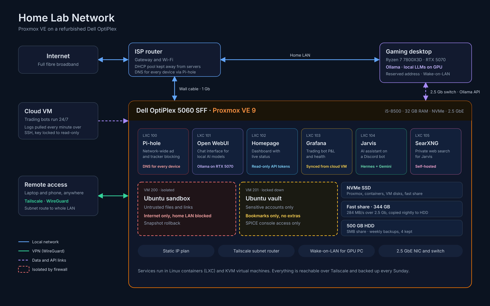

# Home lab

A self-hosted home lab running on a £136 refurbished Dell OptiPlex.

It started as a network-wide ad blocker and grew into a small server platform: virtualisation, remote access, file storage, local AI, a trading dashboard and an always-on AI assistant.

## At a glance

| Area | What runs |
| --- | --- |
| Hypervisor | Proxmox VE 9 on a Dell OptiPlex 5060 SFF (i5-8500, 32 GB RAM, NVMe) |
| Network | 2.5 Gb switch and NIC, static IP plan, Pi-hole DNS for every device |
| Remote access | Tailscale (WireGuard) with a subnet router for the whole LAN |
| Storage | Samba shares: a fast NVMe share (284 MB/s) and a bulk HDD share, nightly copies, weekly backups |
| Local AI | Ollama on an RTX 5070 gaming PC, Open WebUI on the server, Wake-on-LAN and remote shutdown |
| Monitoring | Homepage dashboard, Grafana dashboard for a trading bot hosted on a cloud VM |
| Assistant | Jarvis: Hermes Agent with the Gemini API, a Discord bot and self-hosted SearXNG search |
| Security | Isolated sandbox VM, locked-down VM for sensitive accounts, least-privilege API tokens |

## Services

| ID | Type | Service | Purpose |
| --- | --- | --- | --- |
| 100 | LXC | Pi-hole | DNS and ad blocking for every device on the network |
| 101 | LXC | Open WebUI | Chat interface for local models on the GPU PC |
| 102 | LXC | Homepage | Dashboard with live status of every service |
| 103 | LXC | Grafana | Trading bot P&L and health, synced from a cloud VM |
| 104 | LXC | Jarvis | AI assistant reachable through Discord |
| 105 | LXC | SearXNG | Private web search used by Jarvis |
| 200 | VM | Ubuntu sandbox | Opening untrusted files, cut off from the home LAN |
| 201 | VM | Ubuntu vault | Locked down for sensitive accounts only |

Nothing is exposed to the internet. Remote access goes through Tailscale only.

## Documentation

- [Hardware](docs/hardware.md): the server, upgrades and the gaming PC
- [Network](docs/network.md): addressing plan, router settings, switch, DNS and IPv6
- [Services](docs/services.md): what each container and VM does and how it is set up
- [Storage and backups](docs/storage-and-backups.md): disks, shares, backup jobs, restore order
- [Remote access](docs/remote-access.md): Tailscale subnet routing, Wake-on-LAN, remote shutdown
- [Troubleshooting log](docs/troubleshooting.md): problems I hit and how I fixed them
- [Timeline](docs/timeline.md): how the lab was built, step by step

Example configs (with addresses and secrets replaced by placeholders) are in [`configs/`](configs/) and helper scripts are in [`scripts/`](scripts/).

## Skills used

Proxmox VE · Linux administration · LXC and KVM · networking (DHCP, DNS, static addressing, 2.5 GbE) · VPN (Tailscale/WireGuard) · Samba · systemd · firewall rules · Grafana · Python · local LLMs (Ollama) · AI agents · backup and restore · hardware upgrades and migration

## Next

- Vaultwarden password manager
- Uptime Kuma alerts to my phone
- Hard drive upgrade, then Immich for photos
- ADS-B receiver to track aircraft overhead
- Tech news bot that flags updates and security issues for my hardware
